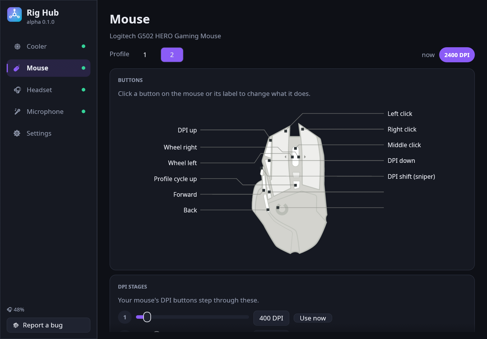

<p align="center"></p>
<h1 align="center">Rig Hub</h1>
<p align="center"><b>One app for your mouse, cooler LCD, headset and mic, on Linux.</b><br>
No more G Hub + iCUE + NZXT CAM. Native, written in Rust, ~15 MB.</p>

<p align="center"></p>

> **Alpha.** It works on the dev's own rig. Expect rough edges and please [report bugs](https://github.com/SusieeTheLinuxUser/rig-hub/issues/new?labels=bug) (there's a button in the app that fills in your system info).

## Install

**Linux / macOS**
```sh
curl -fsSL https://raw.githubusercontent.com/SusieeTheLinuxUser/rig-hub/main/install.sh | sh
```

**Windows** (PowerShell)
```powershell
irm https://raw.githubusercontent.com/SusieeTheLinuxUser/rig-hub/main/install.ps1 | iex
```

**From source**: `cargo install --git https://github.com/SusieeTheLinuxUser/rig-hub`

## What it does

| | |
|---|---|
| 🖱 **Mouse** | Picture of *your* mouse: click a button to remap it (other buttons, DPI/profile actions, any key). Edit DPI stages, switch profiles. Pop-up when you change DPI with the mouse's own buttons. |
| ❄ **Cooler** | Liquid, CPU, pump and fan readouts. Put any image or GIF on the LCD, rotate it to any angle (handy for upside-down mounts), set brightness. |
| 🎧 **Headset** | Battery level, sidetone, auto power-off. Low-battery warning. |
| 🎤 **Mic** | Mute (in sync with the hardware button), gain, monitoring, headphone volume. |
| 📌 **Tray** | Batteries (headset, plus anything UPower sees: UPS, wireless mice, controllers), temps, pump/fan speeds and current DPI in the tray menu. Closing the window keeps it there. |
| 🧩 **KDE widget** | The same at a glance in your Plasma panel: `kpackagetool6 -t Plasma/Applet -i plasmoid` from a checkout, then add "Rig Hub" from Add Widgets. Needs Rig Hub running. |
| 🎨 **Themes** | Midnight, Daylight, Catppuccin Mocha, Nord, Dracula, Gruvbox. |

## Supported hardware

Rig Hub stands on the shoulders of existing open-source drivers, so it supports what they support:

- **Mice**: anything [libratbag](https://github.com/libratbag/libratbag) supports (most Logitech G, Steelseries, Roccat, …). Live DPI pop-ups: Logitech HID++ mice. Needs `ratbagd` running. The mouse picture comes from [Piper](https://github.com/libratbag/piper) if installed.
- **Coolers**: NZXT Kraken Z, Kraken 2024 / Elite 2024 / Plus 2024. LCD protocol ported from [liquidctl](https://github.com/liquidctl/liquidctl).
- **Headsets**: anything [HeadsetControl](https://github.com/Sapd/HeadsetControl) supports (Corsair, Logitech, SteelSeries, HyperX, …).
- **Mics**: Blue Yeti (USB mixer controls via ALSA).

Tested on: Logitech G502 HERO, NZXT Kraken Elite 2024, Corsair HS80 MAX, Blue Yeti.

Keyboards and RGB are out of scope. [OpenRGB](https://openrgb.org) does that well.

### Platform status

| | Linux | Windows | macOS |
|---|---|---|---|
| Cooler LCD | ✅ | 🧪 untested (may need WinUSB driver) | 🧪 untested |
| Cooler temps | ✅ | – | – |
| Mouse | ✅ | – | – |
| Headset | ✅ | 🧪 with HeadsetControl | 🧪 with HeadsetControl |
| Mic | ✅ | – | – |

## Building

```sh
# Debian/Ubuntu: sudo apt install libudev-dev pkg-config
cargo build --release
```

## License

GPL-3.0-or-later (the Kraken LCD code is derived from liquidctl). Mouse artwork is loaded at runtime from your Piper install.
